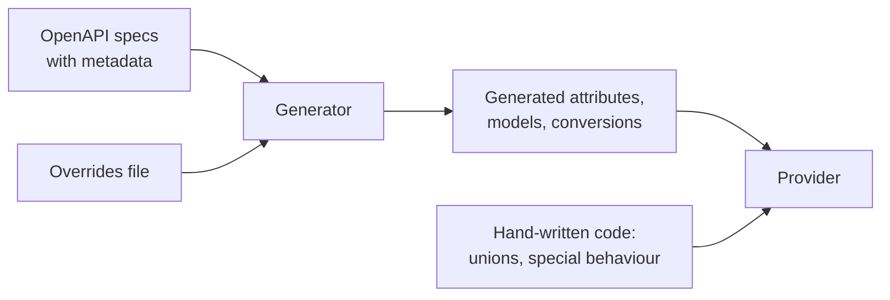

# Generating more of the provider from the OpenAPI spec

## TLDR

Almost everything in this provider is written by hand. Adding one API field means editing about eight places in five files, and a field nobody added gets silently reset on every update. We propose generating more of the provider from the Orchestra OpenAPI specs in stages: first the request and response types, then the Terraform attributes for ordinary fields. Unions, and behaviour the spec can't describe, stay hand-written. Each stage pays off on its own, and the generator fails on any shape it can't map, so it can never again ship an attribute that holds no value.

## Context

The provider manages Orchestra pipelines, monitors, environments, agents and related objects through the Orchestra REST API. Two OpenAPI specs describe that API: the Engine API and the Agents API. Both are generated by pipeline-service and committed to this repo.

The provider used to be generated from the spec, and the generator was removed. HashiCorp's generator turned unions and free-form JSON objects into empty objects. That is how the pipeline resource's `data` attribute shipped unable to hold any value. Since then the rule has been "write it by hand". This plan keeps that lesson but stops paying the full hand-written cost for fields that need no judgment.

What one new field costs today

Adding `subscribers` to `orchestra_monitor` touched:

- the Terraform attribute, plus the hand-written default for its parent object
- the Terraform model struct
- the wire struct sent to the API
- the conversion to the wire format and the conversion back into state
- the test stub's server-side defaults
- the unit and acceptance tests
- the example, the generated docs and the CHANGELOG

Missing any one of these is a bug. Before that change, the field wasn't sent at all, so each update reset whatever had been set in the Orchestra UI.

## Current state

| Layer | Today |
|---|---|
| Enum validator lists | Generated from the spec |
| Reference docs | Generated from the Terraform schemas |
| Endpoint and property coverage | A test fails the build when the spec has an endpoint or a request-body property the provider neither uses nor lists as excluded |
| Request and response types | Hand-written |
| Terraform schemas, models and conversions | Hand-written |
| Field descriptions | Hand-written; the spec has almost none |
| Field behaviour (defaults the API ignores, immutable fields, secrets) | Discovered by testing against the live API |

The fields the provider sends split roughly like this:

| Shape | Share | Can follow a fixed rule? |
|---|---|---|
| Scalars and enums | 72% | Yes |
| Nested objects, lists of objects, typed maps | 12% | Yes |
| Free-form JSON | 12% | Yes: a JSON string attribute, already the repo's rule |
| Unions (one of several shapes) | 4% | No: how to split them is a judgment call |

How these numbers were measured

The count covers every property reachable from the request bodies of the POST, PUT and PATCH operations the provider calls: 162 properties across 33 schemas. Nullable fields (`X | null`) count as their underlying type. The 7 unions include a monitor's `groupBy`, a schedule's `environment` and an environment value's `value`. The hand-written Go outside tests is about 6,900 lines across the resources, agents and data sources.

## Proposed change

Move one layer at a time. Each stage is shippable alone, and the checks from earlier stages keep later ones honest.

| Stage | What changes | Ticket |
|---|---|---|
| Done | The build fails on an unclassified endpoint or request-body property | ENG-12940 |
| Generated types | Request and response types come from the spec, so a spec change becomes a compile error | ENG-12941 |
| Richer spec | Every property gets a description, plus metadata on behaviour: read-only, secret, immutable, an accurate default, not managed by Terraform | ENG-12942, ENG-12943 (pipeline-service) |
| Schema check | A test fails when a hand-written Terraform attribute disagrees with that metadata | ENG-12944 |
| Generated attributes | Terraform attributes, model fields and conversions for ordinary fields come from the spec; an overrides file covers the rest | ENG-12947 |

The schema check is a reasonable place to stop if the generated-attributes stage turns out not to pay for itself. It gets most of the safety for little new machinery.

How the generated-attributes stage works

A small generator in `tools/` reads the committed specs and an overrides file, and writes one generated file per resource package. Hand-written code composes the generated pieces with its own, so a resource can mix both.

Mapping rules, applied to each property:

| Spec | Terraform |
|---|---|
| `string`, `integer`, `number`, `boolean` | `String`, `Int64`, `Float64`, `Bool` attribute |
| `$ref` to an enum | `String` with a `OneOf` validator from `internal/enums` |
| `minLength`, `maxLength`, `pattern`, `minItems`, `maxItems` | The matching validator |
| `required` | `Required`; otherwise `Optional` |
| Accurate `default` | `Optional` + `Computed` + `Default` |
| Default the API doesn't honour | `Computed`, no client-side default |
| `readOnly` | `Computed` only |
| `writeOnly` (secret) | `Sensitive`, and the read keeps the configured value |
| `x-immutable` | A `RequiresReplace` plan modifier |
| `x-terraform: ignore` | No attribute; listed in `coverage.yaml` |
| Object with properties | Single nested attribute; a list of them is a list nested attribute |
| Typed `additionalProperties` | Map attribute |
| Free-form object | JSON string attribute (`jsontypes.Normalized`) |
| Union | Must have an entry in the overrides file; otherwise the generator fails |

The overrides file holds what the spec can't: which spec schema backs which resource, renamed attributes (`connection` is reserved by Terraform), how a union splits into sibling attributes, and any per-field exception. The rule that keeps this safe is the last row of the table: the generator refuses a shape it can't map. It never emits a placeholder.

## Pros and cons

**Pros**
- A new API field becomes a spec change and a regenerate, not eight hand edits.
- Spec drift fails the build instead of silently resetting fields.
- Descriptions are written once and reach the Terraform docs, the API reference and the MCP tools alike.
- Behaviour rules (secrets, immutable fields, defaults) are applied the same way everywhere instead of rediscovered per resource.

**Cons**
- The generator is code we own and maintain, and generated code is harder to step through when debugging.
- The richer-spec stage depends on pipeline-service work, and the `x-` keys become part of the public spec contract.
- The overrides file is one more place to look when a field behaves oddly.
- If anyone relaxes the "fail on an unknown shape" rule, we're back to the original failure.

## Alternatives considered

Options rejected or deferred, and why

- **HashiCorp's `tfplugingen-openapi`**: the generator described under Context. Its intermediate formats also added stages without saving work.
- **Speakeasy** (a commercial service that generates Terraform providers from OpenAPI with annotations): deferred. It could replace most hand-written code, but at a cost, with lock-in, and with unknown handling of our unions and free-form fields. Worth a short evaluation before building the generated-attributes stage.
- **Stop after the schema check**: a valid end state, not rejected. It keeps every safety check but leaves the per-field editing cost.
- **Generate everything, unions included**: rejected. How a union splits into Terraform attributes, and which combinations to reject, are design decisions better made in code.

## Open questions / next steps

- Who in pipeline-service owns the richer-spec stage, and what are the `x-` key names?
- Should Speakeasy get a short evaluation before we build our own generator?
- One overrides file for the repo, or one per resource package?
- After the schema check lands, measure how much hand-written code is left before committing to the generated-attributes stage.

## Glossary

- **pipeline-service**: the Orchestra backend service that serves both APIs and generates their specs.
- **MCP tools**: Orchestra's Model Context Protocol server, whose tools for AI assistants are generated from the same specs.
- **Wire type**: the Go struct that is encoded to, or decoded from, the API's JSON.
- **Terraform attribute**: one field in a resource's Terraform configuration and state.
- **Union**: a spec field that can take one of several shapes (`anyOf` or `oneOf`). Terraform has no equivalent, so the provider splits it into sibling attributes.
- **Free-form object**: a spec field with no fixed shape (`additionalProperties: true`). The provider takes it as a JSON string.
- **`x-` extension**: a custom key in an OpenAPI spec, used for metadata the standard keywords don't cover.
- **Overrides file**: the proposed hand-written file telling the generator what the spec can't.
